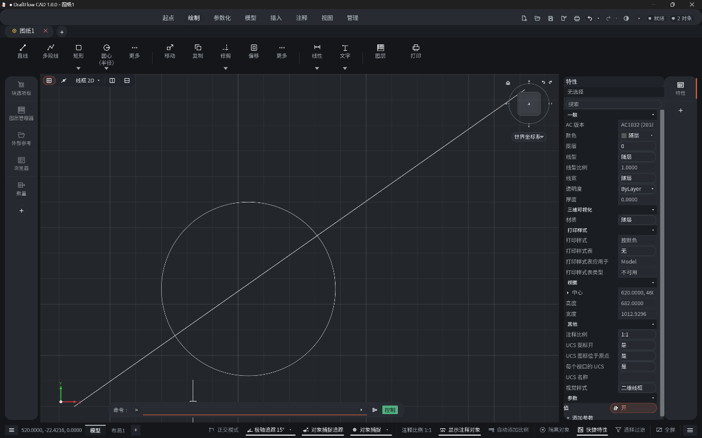

<p align="center">
  
</p>

<h1 align="center">DraftFlow CAD</h1>

<p align="center">
  Open-source 2D drafting and 3D modeling for Windows desktop, built with Rust.
</p>

<p align="center">
  GPL-3.0 licensed · Self-contained build with no runtime network dependencies
</p>

## Overview

DraftFlow CAD is a desktop application for technical drawing, layout work, and solid modeling. It reads and writes DWG and DXF drawings natively.

There is no web or browser version: the application is Windows desktop only.

This is a personal, self-contained build. Keep backups of important production drawings.

## Highlights

- **Native drawing workflow** — open, edit, recover, and save DWG and DXF files without a conversion service.
- **Precise 2D drafting** — lines, polylines, curves, splines, hatches, object snaps, tracking, layers, blocks, and external references.
- **Documentation tools** — text, dimensions, leaders, tolerances, tables, model space, paper space, viewports, and plot styles.
- **Kernel-backed 3D modeling** — solid primitives, extrusion, revolution, sweep, loft, Boolean operations, and ACIS entity tessellation.
- **GPU rendering** — accelerated 2D and 3D viewports through `wgpu`, with orthographic and perspective cameras.
- **Automation** — command scripts, headless conversion, and a line-based JSON automation API.

<p align="center">
  
</p>

## File workflows

| Format or workflow | Support |
| --- | --- |
| DWG | Read and write; versioned save targets from R14 through 2018 |
| DXF | Read and write; versioned save targets from R14 through 2018 |
| BAK / SV$ | Open drawing backups and autosave files |
| OBJ | Import polygon meshes |
| LandXML | Import `CgPoint` survey points |
| STL | Export 3D mesh data |
| STEP AP203 | Export 3D mesh data |
| PDF | Plot layouts and selected geometry on desktop |
| CSV | Extract entity property data |
| CTB / STB | Load and edit plot style tables |

## Desktop

The application provides native file associations, file-manager thumbnails, system printing, PDF output, command scripts, and headless automation.

## Install

Build locally from source — see "Build from source" below. Prebuilt installers
are published on the [Releases](https://github.com/DF172/DFlow/releases) page.

### Windows

- `DraftFlowCAD-1.0.1-x64-setup.exe` — Inno Setup installer (x64). The wizard
  lets you pick the install folder (for example `D:\app\DraftFlowCAD`) and
  installs per user, so no administrator rights are needed. Registers the
  Start-menu and desktop shortcuts, optional `.dwg` / `.dxf` file associations,
  and an uninstall entry under Settings → Apps. Running a later release
  installs over the same folder in place, and the in-app updater downloads the
  same installer and runs it silently. The program is not code-signed, so
  SmartScreen may warn about an unknown publisher. No runtime network access.

## Languages

DraftFlow CAD can follow the system language or use any of these 22 interface languages:

> Arabic · Brazilian Portuguese · Bulgarian · Czech · Dutch · English · Finnish · French · German · Greek · Hindi · Hungarian · Italian · Japanese · Korean · Lao · Polish · Russian · Simplified Chinese · Spanish · Traditional Chinese · Turkish

Change the language from the application settings.

## Build from source

### Desktop

Requirements:

- Git
- Current stable Rust toolchain
- Platform graphics and font development libraries

On Ubuntu or Debian, install the native dependencies with:

```bash
sudo apt update
sudo apt install libgl1-mesa-dev libx11-dev libxcursor-dev libxi-dev \
  libxrandr-dev libxkbcommon-dev libwayland-dev libfontconfig1-dev \
  libfreetype6-dev
```

Then build and run:

```bash
cd DraftFlowCAD
cargo build --release --bin DraftFlowCAD
```

The resulting binary is written to `target/release/DraftFlowCAD` (`DraftFlowCAD.exe` on Windows).

## Automation

The desktop binary supports one-shot conversion, a persistent headless server, and a client-neutral MCP endpoint for AI applications:

```bash
DraftFlowCAD --export input.dwg output.dxf
DraftFlowCAD --export input-r12.dxf output.dwg --target-version R14
DraftFlowCAD --serve
DraftFlowCAD --serve --port 4242
DraftFlowCAD --mcp
```

The automation server exchanges one JSON object per line over standard input/output or a local TCP socket. The self-contained MCP endpoint exposes the live desktop editor through the same tools to every compatible client. Its `audit` and `save_verified` operations check an explicit DWG/DXF target version, lossy records, raw DXF handle references, reopen the output, compare its semantic manifest, and return a SHA-256 hash. To connect a client, configure it to launch `DraftFlowCAD --mcp`. See the [automation guide](docs/automation/guides/workflow.md).

## Project documentation

- [Automation architecture](docs/automation/guides/architecture.md)
- [Automation workflow](docs/automation/guides/workflow.md)
- [Automation capture](docs/automation/guides/capture.md)
- [Batch bindings](docs/automation/batch-bindings.md)

## Contributing

This repository is a personal, self-contained build. Translation and documentation fixes are welcome through issues and pull requests.


Application translations live in `locales/<language>/*.ftl`; source labels map through
`src/locale_catalog.rs`. After editing translations, run `python3 scripts/export-locales.py`
to refresh the desktop packaging labels, then validate with `cargo test --lib i18n::tests`.

## License

DraftFlow CAD is distributed under the [GNU General Public License v3.0](LICENSE).
See [NOTICE.md](NOTICE.md) for attribution of the upstream project it derives from.
